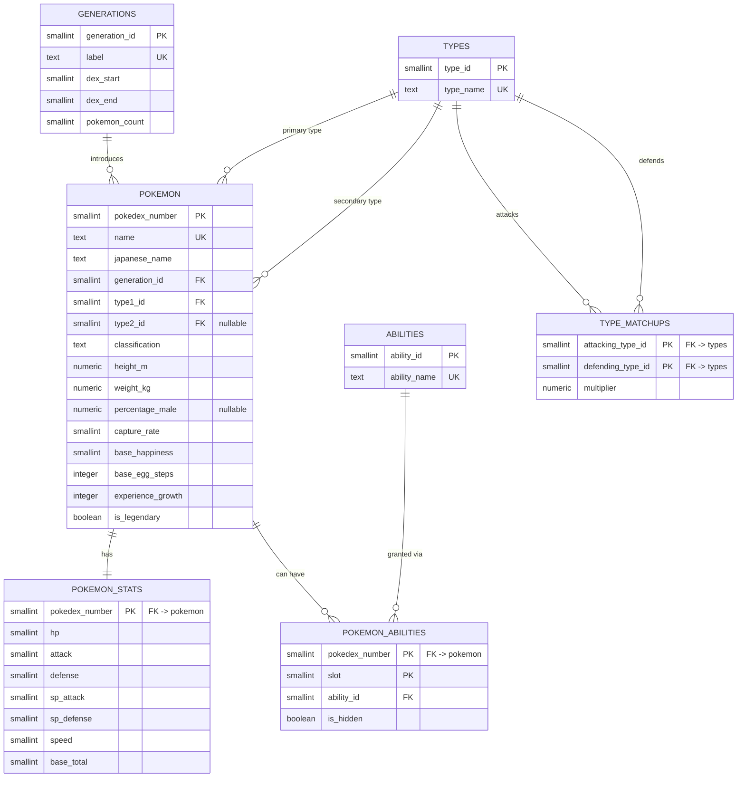

# Entity-Relationship Diagram (Phase 5)

Database: **PostgreSQL**, dedicated schema **`pokemon`**.

Seven base tables, two derived views:

* **`generations`, `types`, `abilities`** — lookup tables (natural surrogate keys).
* **`pokemon`** — one row per base-form Pokédex entry.
* **`pokemon_stats`** — base stats, split out as a **1:1** relation.
* **`pokemon_abilities`** — junction table for the **N:M** `pokemon ↔ abilities`.
* **`type_matchups`** — self-referencing **N:M** on `types` (the 18×18 chart).
* `v_pokemon_profile`, `v_pokemon_type_defense` — derived views.

## Cardinalities

| Relationship | Type | Notes |
|---|---|---|
| `generations` → `pokemon` | 1 : N | every Pokémon belongs to one generation |
| `types` → `pokemon` (`type1_id`) | 1 : N | mandatory primary type |
| `types` → `pokemon` (`type2_id`) | 1 : N | optional secondary type |
| `pokemon` → `pokemon_stats` | 1 : 1 | PK of the child is also the FK |
| `pokemon` ↔ `abilities` | N : M | through `pokemon_abilities` (`slot`, `is_hidden`) |
| `types` ↔ `types` | N : M | through `type_matchups` (self-referential) |

## Integrity rules
* `CHECK (type2_id IS DISTINCT FROM type1_id)` — a Pokémon cannot have two identical types.
* `CHECK (base_total = hp+attack+defense+sp_attack+sp_defense+speed)`.
* `CHECK (is_hidden = (slot = 3))` and `CHECK (slot BETWEEN 1 AND 3)`.
* `CHECK (multiplier IN (0, 0.5, 1, 2))` on the raw chart.
* `UNIQUE (pokedex_number, ability_id)` — a Pokémon cannot have the same ability twice.

The rendered diagram is in [`erd.png`](erd.png) (`python scripts/build_erd.py`).
